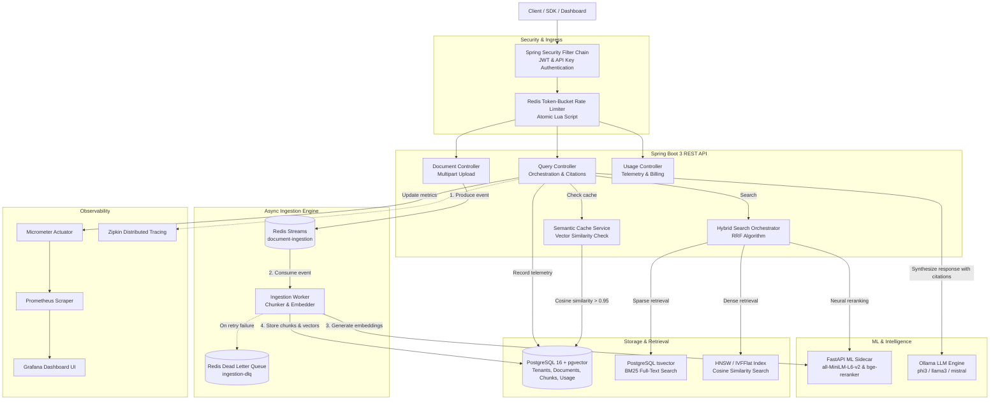

# ⚡ RagForge — Enterprise Multi-Tenant RAG API Platform

[](https://openjdk.org/)
[](https://spring.io/projects/spring-boot)
[](https://github.com/pgvector/pgvector)
[](https://redis.io/)
[](https://fastapi.tiangolo.com/)
[](https://ollama.ai/)
[](https://prometheus.io/)
[](https://grafana.com/)

RagForge is a production-grade, backend-focused Multi-Tenant Retrieval-Augmented Generation (RAG) platform. It provides complete data isolation across organizations, durable asynchronous document ingestion, hybrid search with reciprocal rank fusion (RRF) and neural cross-encoder reranking, semantic caching, token-bucket rate limiting, real-time telemetry, and comprehensive observability.

---

## 🏛 Architecture Diagram



---

## 🚀 Key Features & Implementation Details

### 1. Multi-Tenant Isolation
- Complete logical tenant isolation at every layer.
- Enforced on all queries via authenticated `TenantPrincipal` extracted from JWT or `X-API-Key`.
- Documents, chunks, caches, and usage logs are partitioned by `tenant_id`.

### 2. Async Document Ingestion & Fault Tolerance
- **Redis Streams**: Non-blocking document uploads publish tasks to `document-ingestion` stream.
- **Background Ingestion Worker**: Consumes events, chunks documents with sliding windows, computes embeddings via the ML sidecar, and inserts into PostgreSQL vector store.
- **Dead-Letter Queue & Retries**: Failed ingestions are retried with exponential backoff before routing to `ingestion-dlq`.

### 3. State-of-the-Art Hybrid Search & Reranking
- **Dense Vector Search**: pgvector cosine distance `<=>` utilizing 384-dimensional embeddings.
- **Sparse Full-Text Search**: Native PostgreSQL `tsvector` with English stemming and `ts_rank`.
- **Reciprocal Rank Fusion (RRF)**: Merges dense and sparse ranks:
  $$\text{RRF Score}(d) = \sum_{m \in M} \frac{1}{k + r_m(d)}$$
- **Neural Cross-Encoder Reranker**: Top candidate chunks are reranked via BAAI/bge-reranker-base for maximum contextual precision.

### 4. Semantic Caching
- Caches query-answer pairs alongside query embeddings.
- New queries compute vector similarity against existing cached questions.
- If cosine similarity exceeds **0.95**, cached answer is returned immediately (latency drops from ~1.5s to < 20ms, bypassing LLM generation).

### 5. Distributed Token-Bucket Rate Limiter
- Implemented with atomic Redis Lua scripts to prevent race conditions.
- Configurable requests-per-minute (RPM) per tenant and per API key.
- Returns standard `HTTP 429 Too Many Requests` with `Retry-After` header when exhausted.

### 6. Observability & Telemetry
- **Prometheus & Grafana**: Automated provisioning of Prometheus metrics scraper and pre-configured Grafana dashboard (`/actuator/prometheus`).
- **Distributed Tracing**: Micrometer Tracing with Zipkin exporter traces end-to-end request latency across the API and ML sidecar.
- **Tenant Usage API**: `GET /usage` exposes request counts, cache hit rate, average latency, and endpoint breakdowns for billing and auditing.

---

## 🛠 Tech Stack

| Layer | Technology | Purpose |
|---|---|---|
| **Core API** | Java 17, Spring Boot 3.2 | High-throughput, enterprise REST backend |
| **Security** | Spring Security 6, JJWT | Stateless JWT & hashed API Key authentication |
| **Relational DB** | PostgreSQL 16 | ACID transactions, tenant data, usage logs |
| **Vector DB** | pgvector 0.8.0 | High-dimensional vector indexing & similarity |
| **Migrations** | Flyway | Automated, version-controlled database migrations |
| **Caching / Queue** | Redis 7 Alpine | Redis Streams (queue), String/Hash (cache & rate limiter) |
| **ML Sidecar** | Python 3.11, FastAPI, PyTorch | Sentence-Transformers (`all-MiniLM-L6-v2`, rerankers) |
| **LLM Engine** | Ollama | Local LLM inference (`phi3`, `llama3`, `mistral`) |
| **Metrics & Tracing**| Prometheus, Grafana, Zipkin | Real-time monitoring, alerting, distributed tracing |
| **Containerization**| Docker Compose | Multi-container unified deployment |

---

## 🏁 Quick Start

### Prerequisites
- Docker & Docker Compose
- (Optional for local development) Java 17+, Maven 3.9+, Python 3.10+
- [Ollama](https://ollama.ai/) installed on host (or Docker) with `phi3` or `llama3`:
  ```bash
  ollama pull phi3
  ```

### 1. Clone & Configure Environment
```bash
git clone https://github.com/SriSatya10/ragforge.git
cd ragforge

# Copy and review configuration
cp .env.example .env
```

### 2. Start Services via Docker Compose
```bash
docker compose up -d --build
```

Verify that all services are healthy:
```bash
curl http://localhost:8080/health
```

Expected output:
```json
{
  "status": "UP",
  "postgres": { "status": "UP", "pgvector": "installed" },
  "redis": { "status": "UP", "ping": "PONG" },
  "mlService": { "status": "UP" }
}
```

---

## 📡 API Reference

### Authentication

#### 1. Register Tenant
`POST /auth/register`
```json
{
  "name": "Acme Corp",
  "email": "admin@acme.com",
  "password": "Password123!"
}
```
**Response (201 Created):**
```json
{
  "token": "eyJhbGciOiJIUzI1NiIsIn...",
  "tenantId": 1,
  "email": "admin@acme.com"
}
```

#### 2. Create API Key
`POST /api-keys`
*Header: `Authorization: Bearer <JWT>`*
```json
{
  "name": "Production Key",
  "rateLimitRpm": 120
}
```
**Response (201 Created):**
```json
{
  "id": 1,
  "apiKey": "rf_live_9a8b7c6d5e...",
  "name": "Production Key",
  "rateLimitRpm": 120
}
```

---

### Document Ingestion

#### Upload Document
`POST /documents`
*Header: `Authorization: Bearer <JWT>` or `X-API-Key: <KEY>`*
*Body: `multipart/form-data; file=@document.txt`*

**Response (202 Accepted):**
```json
{
  "documentId": 12,
  "status": "PENDING",
  "message": "Document queued for asynchronous ingestion"
}
```

#### Get Document Status
`GET /documents/{documentId}`
**Response (200 OK):**
```json
{
  "id": 12,
  "filename": "annual-report.pdf",
  "status": "COMPLETED",
  "chunkCount": 24,
  "createdAt": "2026-10-17T18:30:00Z"
}
```

---

### Query & RAG

#### Ask Question
`POST /query`
*Header: `Authorization: Bearer <JWT>` or `X-API-Key: <KEY>`*
```json
{
  "question": "What were the total Q3 revenues?",
  "topK": 3
}
```
**Response (200 OK):**
```json
{
  "answer": "According to the financial report, total Q3 revenue reached $42.5 million, representing a 14% year-over-year growth [Citation 1].",
  "citations": [
    {
      "chunkId": 104,
      "documentId": 12,
      "content": "In Q3, consolidated revenues were $42.5M up from $37.3M in the prior year period...",
      "score": 0.94
    }
  ],
  "cacheHit": false
}
```

---

### Usage & Analytics

#### Get Tenant Usage Summary
`GET /usage`
*Header: `Authorization: Bearer <JWT>`*
**Response (200 OK):**
```json
{
  "tenantId": 1,
  "totalRequests": 1542,
  "totalCacheHits": 438,
  "cacheHitRate": 0.284,
  "averageLatencyMs": 84.6,
  "requestsByEndpoint": {
    "/query": 1280,
    "/documents": 262
  }
}
```

---

## 📊 Monitoring & Dashboards

- **Prometheus UI**: `http://localhost:9090`
- **Grafana Dashboard**: `http://localhost:3000` (User: `admin` / Password: `admin`)
  - Pre-configured dashboard: **RAGForge API Dashboard**
  - Live charts for Request Rate, p95 Latency, Error Rate (5xx), JVM Heap Memory, DB Connection Pool, and Semantic Cache Hit Rate.
- **Zipkin Distributed Tracing**: `http://localhost:9411`

---

## 🧪 Testing & Evaluation

### Run Integration Tests
```bash
cd api
mvn test
```
Tests automatically spin up PostgreSQL with pgvector and Redis via **Testcontainers**.

### Run RAG Pipeline Evaluation (Phase 15)
```bash
python eval/evaluate.py
```
Evaluates keyword retrieval recall, citation groundedness, semantic cache speedups, and verifies tenant usage telemetry.

### Run k6 Load Tests (Phase 16)
```bash
k6 run -e API_URL=http://localhost:8080 loadtest/rag_load_test.js
```

---

## 🗺 Phase Completion Roadmap

- [x] **Phase 1**: Skeleton + Docker infrastructure + pgvector schema
- [x] **Phase 2**: Multi-tenant Auth (JWT + BCrypt) + API Key management
- [x] **Phase 3**: ML Sidecar service (FastAPI + Sentence-Transformers)
- [x] **Phase 4**: Multipart document upload + Redis Stream queuing
- [x] **Phase 5**: Async ingestion worker + chunking + vector indexing
- [x] **Phase 6**: Vector similarity search + `/query` orchestration
- [x] **Phase 7**: Ollama LLM integration + citation attribution
- [x] **Phase 8**: Hybrid search (BM25 full-text + pgvector + RRF + BGE Reranker)
- [x] **Phase 9**: Distributed token-bucket rate limiter via Redis Lua scripts
- [x] **Phase 10**: Ingestion retries + dead-letter queue (DLQ)
- [x] **Phase 11**: Semantic cache with cosine similarity deduplication
- [x] **Phase 12**: Tenant isolation enforcement & integration tests
- [x] **Phase 13**: Observability (Prometheus scraping + pre-provisioned Grafana dashboards)
- [x] **Phase 14**: Usage logging + `/usage` tenant telemetry endpoint
- [x] **Phase 15**: Automated RAG evaluation suite (`eval/evaluate.py`)
- [x] **Phase 16**: k6 performance and load testing scripts
- [x] **Phase 17**: Complete Docker Compose production setup + documentation + architecture diagram

---

## 📄 License
MIT License. Built for modern production AI engineering.
